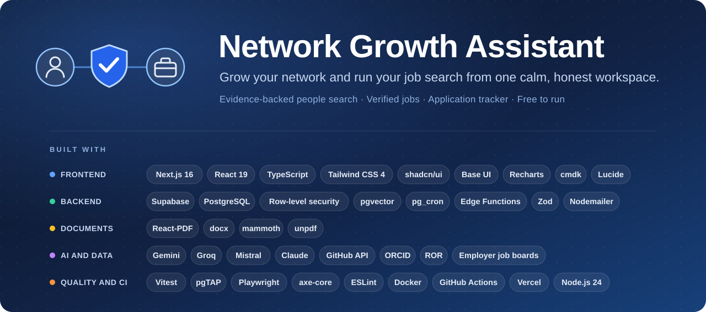
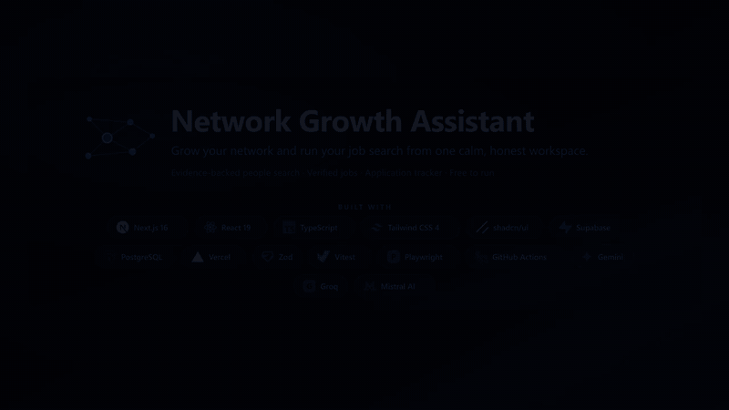
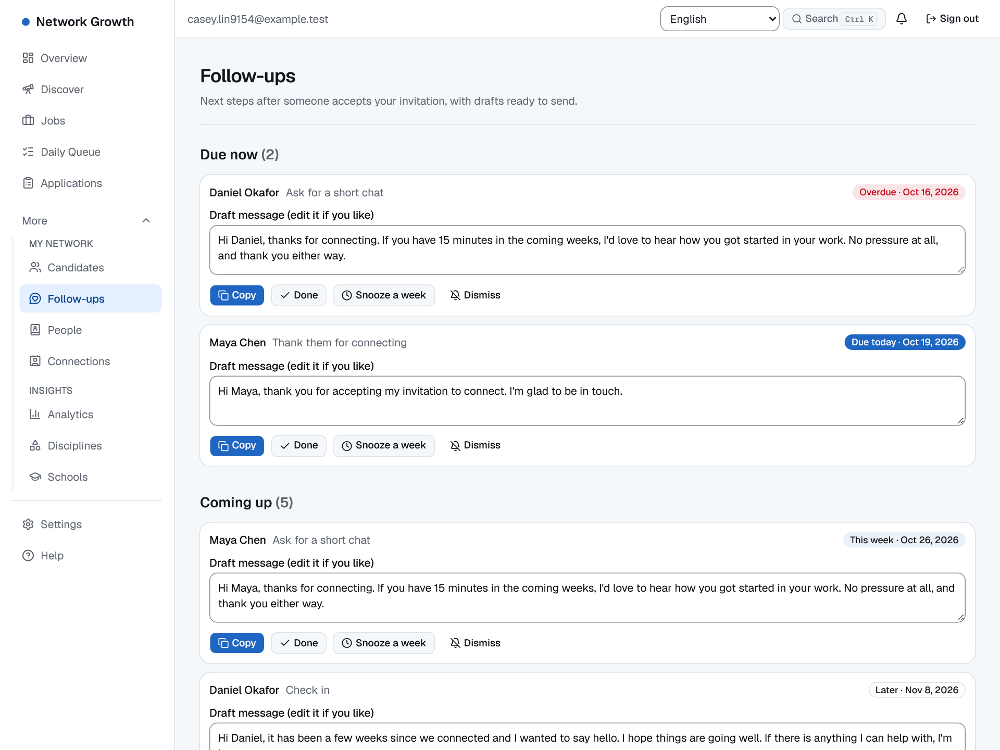
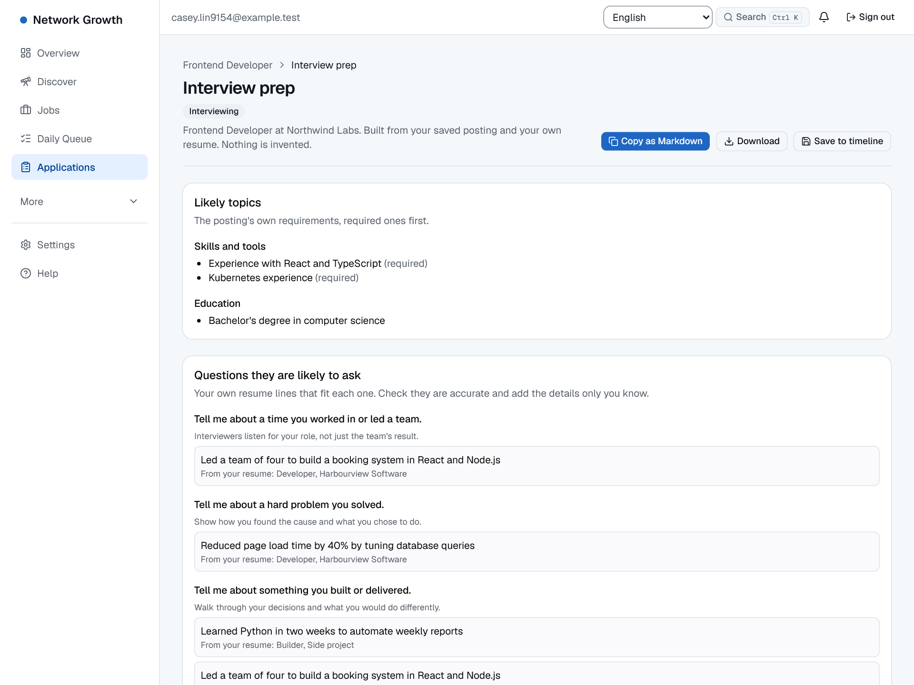
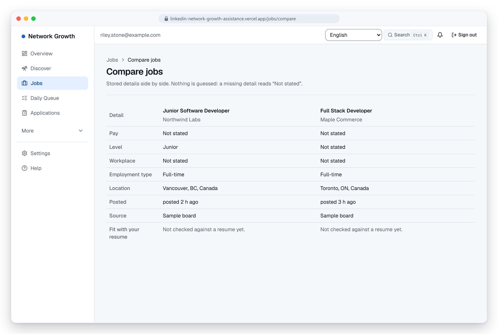
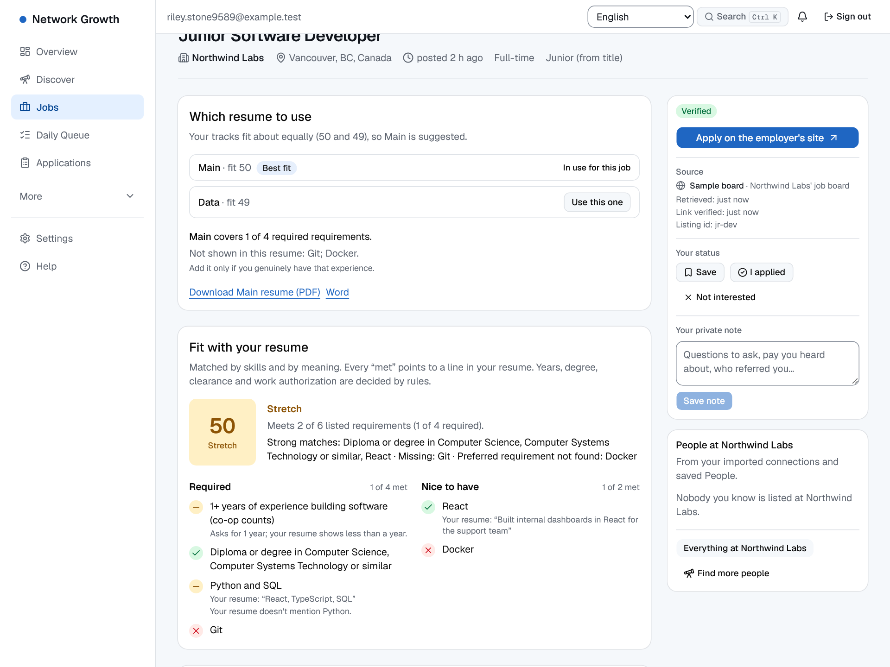
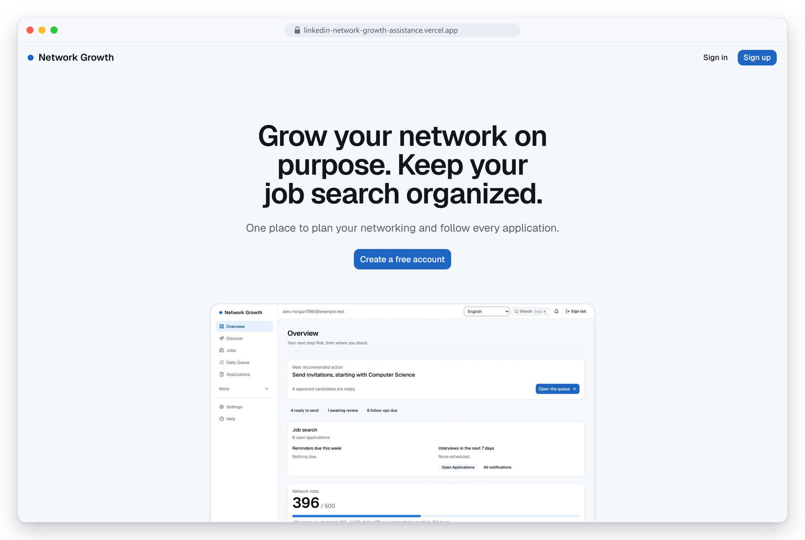
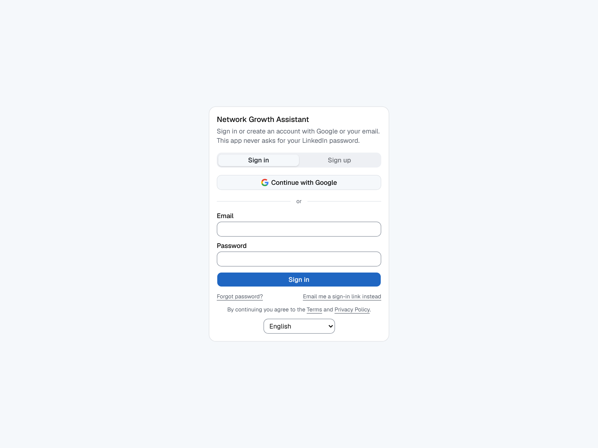
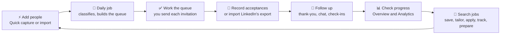
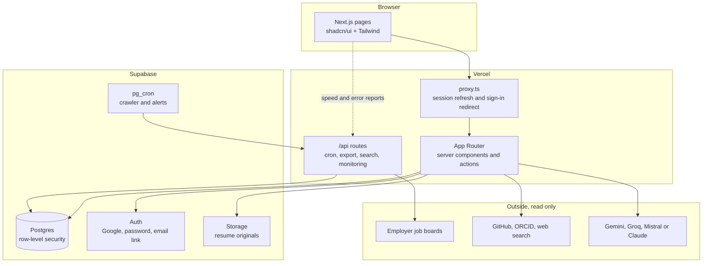

<div align="center">



**Grow your professional network and run your job search from one calm, honest workspace.**

Know who to contact next. Find real, recent jobs from employers' own career pages. Track every application, and every follow-up.

[](https://linkedin-network-growth-assistance.vercel.app)
[](https://github.com/ShervinBabaei2007/Network-Growth-Assistance/actions/workflows/ci.yml)


<br />

<a href="docs/media/demo.mp4"></a>

<sub>A 30-second tour on fictional example data. <a href="docs/media/demo.mp4"><b>Watch the full-quality video (MP4)</b></a>. Regenerate it with <code>npm run docs:video</code>.</sub>

</div>

---

> ### 🛡️ You stay in control
> The app **never scrapes LinkedIn**, **never sends invitations or messages for you** and **never asks for your LinkedIn password**. You open every profile and send every message yourself. It only reads what you paste, import or search for in public sources, and it tells you where every fact came from.

## 📑 Contents

[✨ Showcase](#showcase) · [🧰 What it does](#what-it-does) · [🖼️ Gallery](#gallery) · [📅 How a day works](#how-a-day-works) · [🚀 Quick start](#quick-start) · [🔑 Sign-in](#sign-in) · [⚙️ Configuration](#configuration) · [✅ Checks](#checks) · [☁️ Deploying](#deploying) · [🏗️ How it is built](#how-it-is-built) · [🔒 Privacy](#privacy) · [🩺 Troubleshooting](#troubleshooting) · [⚠️ Limits](#limits) · [🤲 Contributing](#contributing)

---

<a id="showcase"></a>

## ✨ Showcase

Four things that make this different from a spreadsheet.

### 1. ⚡ Quick capture: paste a LinkedIn search page, get a clean list

On a LinkedIn people search, press **Ctrl+A, Ctrl+C**. Back in the app, press **Ctrl+V**. Everyone on the page appears with their school and program already matched to **your own** lists, ready to add in one click. Nothing is fetched from LinkedIn: only what you copied is read.


- 🎯 Matches schools and programs from the wording on the page, using the aliases you set (so "UBC", "U of T" and "UofT" mean what you say they mean).
- 🧹 Skips people you already have and people you're already connected to; flags rows that need a school or program instead of guessing.
- 🔁 After you add the page, the cursor goes back to the paste box: the next page is one Ctrl+V away.

### 2. 🔎 Discover: people worth meeting, with the receipts

Ask in plain language: *"Find 10 UBC alumni who work at Amazon."* A research assistant searches public sources (GitHub, ORCID and optional web search), then **verifies the best matches on their own pages**. It never visits LinkedIn, and it works even when you name no school ("software engineers at startups in Vancouver").


- 📎 **Every fact quotes its source.** The server checks each quote against the page and drops anything it can't find.
- 🧮 **Scores are rules, not vibes.** Education, program, career, company, location and evidence each add a visible number you can inspect.
- 🧭 **It returns fewer people rather than lowering the bar.** Lookalike schools ("New York University" is not "York University"), people with no sign of the company you named, people outside a country you asked for and people you already know are set aside, with the reason shown.
- 📊 **It says how much the public sources know.** "ORCID lists 10 people matching Simon Fraser University + Microsoft" explains a short list. A job on a profile nobody has edited for two years is only a *possible* match, and a city taken from an employer is labelled "Employer's office".
- 🆓 **Free to run.** AI goes through a chain of free services (two Gemini models, then Groq and Mistral if you add their free keys) and falls back to plain evidence rules when they are used up.

<details>
<summary><b>See the evidence drawer</b> (quotes, links, score breakdown, intro message)</summary>
<br />

</details>

### 3. 💼 Jobs: real postings, verified links, fit explained

Search recent jobs in any country and any field. Postings come from **employers' own job boards** (Greenhouse, Lever, Ashby, SmartRecruiters, Workable, Recruitee and Workday) plus free remote-job feeds, and every link is checked before **Apply** turns on.


- ✅ **Verified, or it doesn't get an Apply button.** Links come from the source's own data, never from a pattern or a model.
- 📐 **Fit is explained.** Each requirement is matched against your resume and the card says why: strong matches, what's missing, what's preferred.
- 📄 **Tailor your resume honestly.** AI rewrites a copy only if an accuracy check can back every line; otherwise you get specific improvement notes. Nothing is faked.
- 🔔 Save a search to get alerts in the app (and by email, if you turn that on).
- ⚖️ **Compare, hide, note.** Tick two or three jobs to compare them side by side, hide a company or a title word (with Undo), and keep a private note on each job.
- 🗂️ **A resume per kind of role.** Keep separate base resumes (Software, Data, Product…); each job shows which one fits best and why.

### 4. 📈 Honest progress: pending never counts

Set your own goal, schools, disciplines and targets. The Overview shows where you stand against each one. **Only accepted invitations count toward a target**, and pending ones are shown apart in a hatched segment, so the numbers never flatter you.


- 🧾 The network total comes from counts you record or import, and the page says so, including why it can differ from tracked acceptances.
- 🗂️ Nothing is built in: you define the schools, disciplines, targets and goal. Nursing, law, design or software all work the same.

---

<a id="what-it-does"></a>

## 🧰 What it does

| | Area | What you get |
|---|---|---|
| 🏠 | **Home page and guides** | A short public home page, plus three how-to guides (export your LinkedIn connections, build a networking plan, track job applications). Signed-in people go straight to Overview. |
| 🔑 | **Sign-in** | Sign in or sign up with Google, with email and password (email confirmed, password reset included), or with an emailed sign-in link. |
| 🎬 | **Welcome and example data** | A four-step welcome, an 18-stop tour and a checklist. **Look around with example data** fills an empty account with clearly labelled made-up people, a plan and applications, and one click removes them. Examples are never exported. |
| 👥 | **Network** | Candidates with search, de-duplication and status. Quick capture from a page you copy yourself. CSV and LinkedIn data-export import. A daily queue ordered by your priorities, with suggested connection notes. |
| ☑️ | **Bulk actions and saved views** | On Candidates: tick people to approve, mark not a match, do not contact or delete, with Undo and a count of anyone skipped. Save named filter views; the last filters are remembered; 25, 50 or 100 per page. |
| 💬 | **Follow-ups** | When someone accepts, four suggested touches (thank-you, a short chat, 30- and 90-day check-ins) with editable drafts you copy and send yourself. Done, snooze or dismiss, with Undo. Due ones show on Overview and in the bell. |
| 🔭 | **Discover** | A research assistant that finds people worth meeting from public sources (GitHub, ORCID, optional web search). Every fact quotes its source; fewer people beat weaker evidence. Works with or without a named school. Never visits LinkedIn. |
| 📇 | **People** | A small CRM: status, notes, tags, reminders, referrals and "people at this company". |
| 💼 | **Jobs** | Recent postings from employers' own boards plus free remote feeds. Verified links, fit checks against your resume, tailored resumes and cover letters, saved-search alerts, side-by-side compare, hidden companies and private notes, and a resume track per kind of role. |
| 🗂️ | **Applications** | A board and a list from saved to offer, with timeline, interviews, reminders, contacts, documents and calendar (`.ics`) export. |
| 🎤 | **Interview prep** | For applications in Screening, Interviewing or Offer: likely topics from the posting, your own resume lines matched to common questions, questions to ask them and a checklist for the day. Built only from your records, so it cannot invent experience or company facts. Copy or download as Markdown, or save a copy to the timeline. |
| ⌨️ | **Search and shortcuts** | **Ctrl+K** (or **/**) searches your candidates, people, applications and jobs and jumps to any page. **g** then a letter goes to a page; **?** lists them. Never fires while you type. |
| 📊 | **Overview and Analytics** | Progress toward your goal, by discipline and school. Nothing is estimated or invented. |
| 🌐 | **English and Canadian French** | Menu, top bar, sign-in, welcome, banners and search are available in French. Other pages are still English (see [Limits](#limits)). |
| 👤 | **Your account** | Export or delete all your data from Settings. Add your own free AI key (stored encrypted) for unlimited AI use. Light and dark themes, adjustable density and text size. |
| 📱 | **Phone friendly** | Lists become cards, filters tuck behind a button, touch targets are bigger and dropdowns use your phone's own picker. |
| 🩺 | **Monitoring and cost control** | Page-speed and error reports kept in your own database, with no personal data and nothing sent to a third party. An operator script also prints database size against the plan, AI use and the largest tables, and the daily job shortens old postings to stay within the free tier. |
| 🆓 | **Free to run** | No paid API is needed. Jobs use employers' public boards; Discover uses GitHub and ORCID; AI uses free tiers and degrades to plain rules when they run out. |

For the detail behind each feature and what is not built, see the [feature guide](docs/FEATURES.md).

<a id="gallery"></a>

## 🖼️ Gallery

<sub>Fictional data. Every picture here is generated from the app with <code>npm run docs:screenshots</code>.</sub>

<table>
  <tr>
    <td width="50%"><a href="docs/images/applications.png"></a><br /><sub><b>🗂️ Applications board</b>: every job from saved to offer, each move kept on a timeline.</sub></td>
    <td width="50%"><a href="docs/images/analytics.png"></a><br /><sub><b>📊 Analytics</b>: acceptance rate that leaves out unresolved invitations, plus weekly activity.</sub></td>
  </tr>
  <tr>
    <td width="50%"><a href="docs/images/resume.png"></a><br /><sub><b>📄 Resume</b>: read without AI; uncertain fields are marked <i>Needs review</i> with the reason.</sub></td>
    <td width="50%"><a href="docs/images/overview-dark.png"></a><br /><sub><b>🌙 Dark theme</b>: light, dark or follow your system, with density and text size controls.</sub></td>
  </tr>
  <tr>
    <td width="50%"><a href="docs/images/follow-ups.png"></a><br /><sub><b>💬 Follow-ups</b>: a thank-you, a short chat and check-ins after someone accepts, with drafts you copy and send yourself.</sub></td>
    <td width="50%"><a href="docs/images/interview-prep.png"></a><br /><sub><b>🎤 Interview prep</b>: built only from your posting and your own resume lines, so it cannot invent experience.</sub></td>
  </tr>
  <tr>
    <td width="50%"><a href="docs/images/jobs-compare.png"></a><br /><sub><b>⚖️ Compare jobs</b>: two or three postings side by side; a missing detail reads "Not stated".</sub></td>
    <td width="50%"><a href="docs/images/resume-tracks.png"></a><br /><sub><b>🗂️ Resume tracks</b>: a base resume per kind of role, with the fit of each and what it does not show.</sub></td>
  </tr>
  <tr>
    <td width="50%"><a href="docs/images/home.png"></a><br /><sub><b>🏠 Home page</b>: what the app is, in one column, with the questions people ask.</sub></td>
    <td width="50%"><a href="docs/images/login.png"></a><br /><sub><b>🔑 Sign in</b>: Google, email and password, or an emailed link.</sub></td>
  </tr>
</table>

<div align="center">

### 📱 On a phone


<sub>Overview · Candidates as cards · Jobs · Menu</sub>

</div>

<a id="how-a-day-works"></a>

## 📅 How a day works



1. **Add people fast.** On a LinkedIn people search, press Ctrl+A then Ctrl+C. In **Candidates → Quick capture**, press Ctrl+V. Fix any blanks, then press **Add**.
2. **Let the daily job run** (or press **Run now**). It classifies new candidates, marks older invitations as pending and builds today's queue within your daily target.
3. **Work the queue.** Open each profile on LinkedIn, send the invitation yourself, then press **Mark sent**.
4. **Record acceptances.** Mark them on the person's record, or import LinkedIn's data export to update everyone at once. Each acceptance creates its follow-ups.
5. **Follow up.** Open **Follow-ups**, copy a draft, send it on LinkedIn yourself and mark it done.
6. **Check progress** on Overview, Disciplines, Schools and Analytics.
7. **Search jobs.** Save a search to get alerts, track what you apply for, look up people you know at each company, and open **Interview prep** once you reach screening.

<a id="quick-start"></a>

## 🚀 Quick start

You need **Node 24** and **Docker Desktop** (running).

```sh
npm install
npm run db:start            # starts local Supabase in Docker and applies migrations
cp .env.example .env.local
npx supabase status         # copy the publishable key and secret key into .env.local
npm run dev                 # http://localhost:3000
```

Then:

1. Set `CRON_SECRET` in `.env.local` to any random string of 16 or more characters.
2. Open http://localhost:3000 and choose **Sign up** (or **Sign in**).
3. Local emails never leave your machine. Open **Mailpit** at http://127.0.0.1:54324 to read the confirmation or sign-in link and click it.

> [!CAUTION]
> **Careful with `npm run db:reset`.** It erases your local database. If it holds data you want, apply new migrations with `npx supabase migration up --local` instead.

<details>
<summary><b>📜 npm scripts</b></summary>

| Script | What it does |
|---|---|
| `npm run dev` / `build` / `start` | Run, build and serve the app. |
| `npm run typecheck` / `lint` | Type-check and lint. |
| `npm test` | Vitest unit tests. |
| `npm run test:db` | pgTAP: security rules and data constraints (needs `db:start`). |
| `npm run test:e2e` | Playwright end to end, including an accessibility scan (needs `db:start`). |
| `npm run check:bundle` | Confirms no AI key reaches the browser (run after a build). |
| `npm run check:budget` | Fails if any route's first-load JavaScript grew more than 5% over `scripts/route-budgets.json` (run after a build; add `-- --update` to accept new sizes). |
| `npm run smoke -- <url>` | Public smoke checks against a running deployment. |
| `npm run ops:report -- <url>` | Prints real-user page speed and recent errors (needs `CRON_SECRET`). |
| `npm run db:start` / `db:reset` / `db:types` | Local Supabase, and regenerate the database types. |
| `npm run employers:discover` / `employers:load` | Employer directory tools for the job crawler. |
| `npm run docs:screenshots` | Regenerates the pictures in this README from the app (needs `db:start`). |
| `npm run docs:video` | Records the 30-second tour from the app and encodes `docs/media/demo.mp4` and `docs/images/demo.gif` (needs `db:start`). |
| `npm run docs:banner` | Rebuilds the banner at the top of this README. |
| `npm run docs:check` | Fails on a broken link, anchor or image, an `npm run` script or environment variable that doesn't exist, or a wrong migration or test count in the docs. |
| `npm run bench:seed` / `bench:explain` / `bench:clean` | Fills a separate local user with 20,000 rows, prints query plans and times, and removes it. Local database only. |
| `bash scripts/restore-rehearsal.sh` | Backs up the local database, restores it into a scratch database and compares every table. |

</details>

<a id="sign-in"></a>

## 🔑 Sign-in

The sign-in page has **Sign in** and **Sign up** tabs, a **Continue with Google** button, and a link to use an emailed sign-in link instead of a password.

**Email.** Locally, emails go to Mailpit (http://127.0.0.1:54324). On a deployed site Supabase's built-in email sends very little and is meant for testing, so add your own SMTP provider (Supabase **Project Settings → Authentication → SMTP Settings**). Also set, in the dashboard under Authentication: **Confirm email** on, minimum password length 8, and **Site URL** and **Redirect URLs** to your site. The local `supabase/config.toml` sets these only for your own computer.

**Google, locally.** Google is already switched on in `supabase/config.toml`, but it needs your own Google client:

1. In [Google Cloud Console](https://console.cloud.google.com), create a project, set up the OAuth consent screen (External; add yourself under **Test users**), then **Credentials → Create credentials → OAuth client ID → Web application**.
2. Add the authorised redirect URI `http://127.0.0.1:54321/auth/v1/callback` exactly (`127.0.0.1`, `http`, no trailing slash).
3. Copy `supabase/.env.example` to `supabase/.env` and fill in `GOOGLE_CLIENT_ID` and `GOOGLE_CLIENT_SECRET`. The file is git-ignored.
4. Run `npx supabase stop`, then `npm run db:start`.

Until you do, the button returns to the sign-in page with "Google sign-in isn't available right now" and, locally, a note saying what is missing.

**Google, deployed.** Create a second client whose redirect URI is `https://<project-ref>.supabase.co/auth/v1/callback`, then turn Google on in Supabase **Authentication → Sign In / Providers → Google** and paste its ID and secret. Details are in [docs/DEPLOYMENT.md](docs/DEPLOYMENT.md#google-sign-in).

<a id="configuration"></a>

## ⚙️ Configuration

Copy `.env.example` to `.env.local` for local work. On Vercel, add the same names under **Settings → Environment Variables** for the **Production** environment. Variable names must match exactly: a misspelled name is silently ignored.

**Required**

| Name | Purpose |
|---|---|
| `NEXT_PUBLIC_SUPABASE_URL` | Your project address, such as `https://<ref>.supabase.co`. Not the dashboard address. |
| `NEXT_PUBLIC_SUPABASE_PUBLISHABLE_KEY` | Browser key. Access is enforced by row-level security. |
| `SUPABASE_SECRET_KEY` | Server only. Bypasses row-level security. Used by scheduled jobs, monitoring and account deletion. |
| `CRON_SECRET` | Server only. Authenticates scheduled calls to `/api/cron/*` and the operator report at `/api/ops/monitoring`. Must match the value Supabase stores for its scheduled calls. |

**Recommended**

| Name | Purpose |
|---|---|
| `GEMINI_API_KEY` | Free key from [Google AI Studio](https://aistudio.google.com/apikey). Turns on AI features. Without any AI key, every feature uses its non-AI path. |
| `GROQ_API_KEY`, `MISTRAL_API_KEY` | Free keys, no card ([Groq](https://console.groq.com), [Mistral](https://console.mistral.ai)). Each adds its own daily AI allowance, used when the Gemini models run out. Mistral's free plan may train on prompts: Discover sends only public web text. |
| `AI_DAILY_QUOTA` | Jobs AI uses (tailoring, notes, AI resume reading) per user per day on your key. Unset means no limit, so set it on a public site. `0` means users' own keys only. |
| `DISCOVERY_AI_SEARCHES` | AI-assisted Discover searches per person per day on your free AI (default 6; `0` turns it off for Discover). A person's own key in Settings has no limit. |
| `APP_ENCRYPTION_KEY` | 32+ random characters. Lets users store their own AI key. Never change it once keys are stored. |
| `EMBED_SECRET` | 16+ random characters. Turns on matching by meaning (see [Deploying](#deploying)). |
| `GITHUB_TOKEN` | Free token with no scopes. Raises GitHub's limit for Discover from 60 to 5,000 profile lookups an hour. |
| `NEXT_PUBLIC_CONTACT_EMAIL`, `NEXT_PUBLIC_OPERATOR_NAME` | Shown on the Privacy Policy and Terms pages. Set them before launch. |
| `NEXT_PUBLIC_FEEDBACK_URL` | A `mailto:` or form link. Shows a **Send feedback** button in the navigation. |
| `APP_URL` | Your public address. Also used for the sitemap and canonical links. |

**Optional**

| Name | Purpose |
|---|---|
| `GEMINI_MODELS` | Comma list of Gemini models to chain, each with its own free daily quota. Default `gemini-flash-lite-latest,gemini-3.8-flash`. `GEMINI_MODEL` (one model) still works. |
| `OPENROUTER_API_KEY` | A last-resort free AI service (50 requests a day). |
| `ANTHROPIC_API_KEY` | Anthropic Claude, last in the chain. Pay as you go: leave it unset to stay free. |
| `DB_LIMIT_MB`, `OPERATOR_USER_ID` | Your database plan size in MB (default 500) and your own user id. At 70% full the daily job logs a warning and sends you one bell notification a month. |
| `TAVILY_API_KEY` | Adds public web search to Discover (free plan, no card). `BRAVE_SEARCH_API_KEY` also works. |
| `CAREERJET_API_KEY` | Adds Careerjet to job searches (free publisher key). |
| `ADZUNA_APP_ID`, `ADZUNA_APP_KEY` | Adds Adzuna to job searches. |
| `USAJOBS_API_KEY`, `USAJOBS_EMAIL` | Adds U.S. federal jobs. |
| `SMTP_HOST`, `SMTP_PORT`, `SMTP_USER`, `SMTP_PASS`, `SMTP_FROM` | Email digests for saved-search alerts (separate from sign-in email, which Supabase sends). |
| `EMAIL_TOKEN_SECRET` | Also needed for alert emails (one-click unsubscribe). 32+ characters. |

Alert emails switch on only when `SMTP_HOST`, `SMTP_FROM`, `APP_URL` and `EMAIL_TOKEN_SECRET` are all set, and each person opts in. Otherwise alerts appear only in the app.

**Supabase local file.** `supabase/.env` (git-ignored) holds `GOOGLE_CLIENT_ID` and `GOOGLE_CLIENT_SECRET` for local Google sign-in. See `supabase/.env.example`.

**Tests only.** `DISCOVERY_FIXTURES` and `JOBS_FIXTURES` switch on built-in fictional data. Never set them in production. They are ignored in production builds.

<a id="checks"></a>

## ✅ Running the checks

```sh
npm run typecheck
npm run lint
npm test              # Vitest unit tests
npm run test:db       # pgTAP: security rules and data constraints (needs db:start)
npm run test:e2e      # Playwright end to end (needs db:start)
npm run build
npm run check:bundle  # confirms no AI key reaches the browser (run after build)
npm run check:budget  # first-load JavaScript per route stays within budget (run after build)
```

The last full run passed **1,051 unit tests, 297 database tests and 89 end-to-end tests** (desktop and phone), plus the build, the bundle check and the route budget. `.github/workflows/ci.yml` runs the same checks on every pull request and push to `main`; it has run on GitHub and the badge above shows its latest result. `npm run docs:check` keeps these numbers, the links and the environment variables in this README and `docs/` honest.

- **Run the end-to-end tests with a fresh build folder.** Running `npm run build` and then Playwright straight away can break the dev server, because both use `.next`. Run the tests first, or delete `.next` in between.
- **Wait for hydration in new sign-in tests.** The sign-in page is plain HTML until its JavaScript loads, and a click before then does nothing, so tests wait for the page to settle.
- **Local sign-in limits.** `supabase/config.toml` raises the local sign-in rate limit so the suite can create many users. Restart Supabase after changing it.

| Quality | Result |
|---|---|
| ♿ Automated accessibility | An axe-core scan (WCAG A and AA) of the public pages and every main signed-in page runs in the end-to-end tests, in light and dark, desktop and phone. Serious and critical findings fail the run. |
| ♿ Screen reader | **Not done.** The checklist is in [docs/ACCESSIBILITY.md](docs/ACCESSIBILITY.md). |
| 🎨 Colour contrast | Every text and form-field pair is unit-tested in both themes (`src/lib/contrast.test.ts`) |
| ⚡ Lighthouse | Accessibility, best practices and SEO scored 100 and performance 93–99 on 11 of 12 pages when last measured on production, before the newest features. They have not been re-measured. |

After you change a migration, run it locally, then `npm run db:types` to regenerate `src/lib/supabase/database.types.ts`.

<a id="deploying"></a>

## ☁️ Deploying

The app runs on **Vercel** (web app and one daily job) and **Supabase** (database, sign-in, file storage and an optional embedding function). The full, step-by-step guide is in [docs/DEPLOYMENT.md](docs/DEPLOYMENT.md). In short:

1. Create a Supabase project, then link it and apply the migrations (there are 31, and the newest features need them):
   ```sh
   npx supabase login
   npx supabase link --project-ref <your-project-ref>
   npx supabase db push
   ```
2. Import the repository in Vercel and add the environment variables above. The function region is set to `pdx1` in `vercel.json`: keep it next to your Supabase region.
3. In Supabase **Authentication → URL Configuration**, set **Site URL** to your Vercel address and add it, with `/**`, to **Redirect URLs**. Turn on **Confirm email** and set the minimum password length to 8.
4. Set up custom SMTP, and Google sign-in if you want it (see [Sign-in](#sign-in)).
5. Load the employer directory: `npm run employers:load` (with the project URL and secret key in your environment).
6. Schedule the job crawler (every 5 minutes) and the alerts job (every 15 minutes) with Supabase `pg_cron`. Vercel's free plan runs a cron only once a day. The SQL is in the deployment guide.
7. Optional: `npx supabase functions deploy embed`, for matching by meaning.
8. After deploying, run `npm run smoke -- https://<your-app>`. Use a separate staging project for anything that creates accounts.

The app serves `robots.txt` (crawling allowed), a sitemap and `llms.txt` for its public pages (home, guides, sign-in, privacy, terms). Pages behind sign-in redirect signed-out visitors, bots included, to `/login`.

<a id="how-it-is-built"></a>

## 🏗️ How it is built

**Stack.** Next.js 16 (App Router, streaming, partial prerendering) on React 19, TypeScript, Tailwind v4, shadcn/ui on Base UI, cmdk (search palette) and Recharts (both loaded on demand), Supabase (Postgres, Auth, Storage, row-level security, pg_cron), Zod, `@react-pdf/renderer`, `docx`, `mammoth` and `unpdf` for resumes, Nodemailer for alert email, and Vitest, pgTAP and Playwright with axe-core for tests. AI is a chain of free services over plain REST (Gemini models, then Groq and Mistral), with optional Anthropic; ORCID and GitHub supply the people.



```text
src/app/page.tsx   the public home page; src/app/guides/ the public how-to guides
src/app/(app)/     signed-in pages: overview, queue, candidates, follow-ups, discover, people,
                   jobs, applications (and interview prep), companies, notifications,
                   settings, analytics
src/app/api/       cron jobs (daily, crawl, alerts), export, search, vitals and error
                   reports, operator monitoring, email unsubscribe, JSON endpoints
src/app/login/     sign-in and sign-up; src/app/auth/ callbacks and password reset;
                   privacy and terms pages are public
src/lib/           the logic: job-postings, discovery, ai (the free-service chain), alerts,
                   applications, follow-ups, interview-prep, progress, classify, i18n, monitoring,
                   ops (storage and cost), net (safe fetching), server, email
src/components/    shared interface pieces (components/ui is shadcn)
src/proxy.ts       refreshes the session, sends signed-out visitors to /login, and sends
                   signed-in visitors from the home page to Overview
src/instrumentation.ts   records server errors (scrubbed) next to the logs
supabase/          migrations, pgTAP tests, seed employers, the embed function, local config
e2e/               Playwright tests, fixtures and the README screenshot and video scripts
scripts/           employer tools, bundle and route-budget checks, smoke checks, operator
                   report, restore rehearsal, benchmark data, docs tools (scripts/docs)
docs/              deployment guide, feature guide, accessibility, implementation checklist,
                   images and the demo video (docs/images, docs/media)
```

**Design rules worth knowing**

- 🔐 Every table is protected by row-level security and scoped to its owner. Client input never names the user. The monitoring tables have no user data and are reachable only by the server.
- 🌐 Fetching outside URLs goes through `src/lib/net/safe-fetch.ts`, which refuses private and reserved addresses.
- 🧮 Scores, rankings, fit, follow-up drafts and interview prep are computed by rules, never by a model. AI writes text where it is used, and its output is checked before use.
- 🎯 Counting rules for targets live in `src/lib/progress/`, with unit tests. Only accepted invitations count, and only when the person's school and program are confirmed. Example data is flagged `is_sample` and never exported.
- 🔑 AI keys never reach the browser. `npm run check:bundle` checks the built files.
- ⚡ The first page load stays light: menus, charts, toasts, the search palette and the welcome load only when first used. Only the language in use is sent to the browser. `npm run check:budget` guards each route's size.
- 🌐 Text lives in typed message files (`src/lib/i18n/messages`): the French file must have exactly the English keys or the build fails.
- 📱 Dropdowns are the shadcn Select on desktop and the phone's own picker on touch devices; lists turn into cards below 768 px.

<a id="privacy"></a>

## 🔒 Privacy and data

- Everything is stored only for your account. Your LinkedIn password and cookies are never stored. Email addresses in imported files are not stored, and the files are not kept.
- Settings can export everything in your account and delete it for good.
- Page-speed and error reports go to your own database, not to an analytics company. They hold only the page type, a measurement or a cleaned error message and phone-or-computer, with no account, IP address or page content, and are deleted after 30 or 90 days. Nothing is sent if the browser says Do Not Track.
- When you use an AI feature, the text it needs (for example your resume and a job posting) goes to the AI provider. **On free tiers (Gemini, Mistral), the provider may use it to improve its products.** Use a paid key, or skip AI features, if that matters to you. Discover sends only public web text, never your records.
- The site has a [Privacy Policy](src/app/privacy/page.tsx) and [Terms of Service](src/app/terms/page.tsx), written to follow British Columbia law. They are a starting point, not legal advice. Have them reviewed before a wide launch.

<a id="troubleshooting"></a>

## 🩺 Troubleshooting

| Symptom | Likely cause and fix |
|---|---|
| "Google sign-in isn't available right now" | Google has no client set up. Locally, follow [Sign-in](#sign-in) and restart Supabase. Deployed, turn Google on in Supabase **Authentication → Sign In / Providers**. |
| Google says `redirect_uri_mismatch` | The redirect URI in Google Cloud differs from `http://127.0.0.1:54321/auth/v1/callback` (local) or `https://<ref>.supabase.co/auth/v1/callback` (deployed). It must match exactly. |
| Google says "Access blocked" | Your email isn't listed under **Audience → Test users**, or the app is still in testing. |
| Google button shows a Supabase page, or a "not found" page | `NEXT_PUBLIC_SUPABASE_URL` holds the dashboard address. It must be `https://<ref>.supabase.co`. Fix it and redeploy. |
| Sign-in sends people to a Vercel "request access" page | **Site URL** in Supabase is wrong. Use your public Vercel address, with no path. |
| Sign-up or reset emails never arrive (deployed) | Supabase needs custom SMTP for anyone outside your team. Check spam, too. Locally, read them in Mailpit at http://127.0.0.1:54324. |
| Confirmation or reset link is refused | The site address is missing from **Redirect URLs** (add `https://<your-site>/**`). |
| Scheduled crawl returns `401` | `CRON_SECRET` in Vercel differs from the one stored in Supabase. They must match exactly. Redeploy after changing it. |
| Jobs page is empty | Run `npm run employers:load`, then schedule the crawler. First results take about 10 minutes. |
| "Email isn't set up on this server" in Settings | One of `SMTP_HOST`, `SMTP_FROM`, `APP_URL` or `EMAIL_TOKEN_SECRET` is missing, misspelled, or not set for Production. Redeploy afterwards. |
| New pages or features fail on the deployed site | The newest migrations haven't been applied. Run `npx supabase db push`. |
| Local end-to-end tests fail all at once | The dev server broke after a build. Delete `.next` and run again. |
| Local sign-in fails with a rate-limit error | Too many sign-ins in five minutes. `supabase/config.toml` raises the limit; restart Supabase after changing it. |
| A new variable has no effect | Variables apply only to new deployments. Redeploy, and for `NEXT_PUBLIC_` ones, rebuild. |
| Discover says "AI wasn't used for this search" | The free AI is used up for today, or the person has used their share of `DISCOVERY_AI_SEARCHES`. Add `GROQ_API_KEY` or `MISTRAL_API_KEY`, or ask the person to add their own free key in Settings. Results are still scored from the evidence. |
| Discover finds few or no people | Public sources only hold what people published. The page says how many people ORCID lists for your request. Name a school or a place, and set a free `GITHUB_TOKEN` (GitHub allows only 60 profile lookups an hour without one). |

<a id="limits"></a>

## ⚠️ Limits

- **French is partial.** Only the menu, top bar, sign-in, welcome, banners and search are translated. Every other page, the home page, guides, legal pages, the tour, emails, and dates, numbers and money on those pages are English.
- **Bulk actions and saved views are on Candidates only,** not People or Applications. There are no `j`/`k` list shortcuts.
- **Interview prep and follow-up drafts use fixed templates and word matching.** There is no AI rewrite, and no company facts are added.
- **Monitoring has no web dashboard.** The report is a script and a protected JSON route, and nothing alerts you when a new error appears.
- **Discover is limited by what is public.** ORCID mostly lists researchers, so ordinary engineers appear mainly through GitHub or optional web search. "Verified" means every part of the request is stated in a public source the app quotes, not that anyone else checked it. Whether an employer is a startup is not stated in public records, so such requests return *possible* matches. A narrow request (a school plus one employer plus a city) may honestly return only a few people.
- Job coverage follows the employer directory. Large retailers and many big employers use systems with no public API, so in-store retail jobs stay thin. The app does not scrape.
- Jobicy and Remotive list only remote jobs, and Remotive's arrive a day late.
- Free AI tiers have daily request limits (the full Gemini Flash model allows about 20 requests a day). The app chains several free services and each person gets a few AI-assisted Discover searches a day; when all are used up, Tailor Resume gives improvement notes and Discover scores from evidence alone.
- Links on sites that block automated checks stay **Not yet verified**.
- **Still open before a wide launch:** a screen-reader review, a staging deployment with the smoke checks run against it, restoring a backup into a hosted project (only a local rehearsal is done), re-measuring Lighthouse on the newest pages, and a legal review of the Privacy Policy and Terms.

<a id="contributing"></a>

## 🤲 Contributing and licence

Questions, bug reports and ideas are welcome. Please open an issue, or use the **Send feedback** button in the app. If you plan to send a change, run the checks above first and keep the change small and focused. To refresh the pictures and the demo video in this README after a visual change, run `npm run db:start`, then `npm run docs:screenshots` and `npm run docs:video`; run `npm run docs:check` after editing any document.

No licence has been chosen yet, so all rights are reserved. Please ask before reusing the code.

This project is not affiliated with LinkedIn, Google or any employer.

<div align="center">
<sub>Built with Next.js, Supabase and shadcn/ui · Your network, your rules.</sub>
</div>
