<div align="center">

# 🤝 Network Growth Assistant

**Grow your professional network and run your job search from one calm, honest workspace.**

Keep your lists. Know who to contact next. Find real, recent jobs from employers' own career pages. Track every application.

[](https://linkedin-network-growth-assistance.vercel.app)
[](https://nextjs.org)
[](https://www.typescriptlang.org)
[](https://tailwindcss.com)
[](https://ui.shadcn.com)
[](https://supabase.com)


<br />

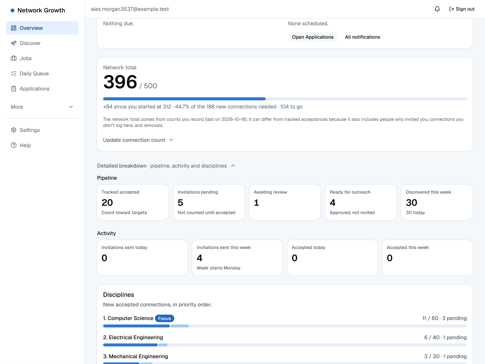
&nbsp;
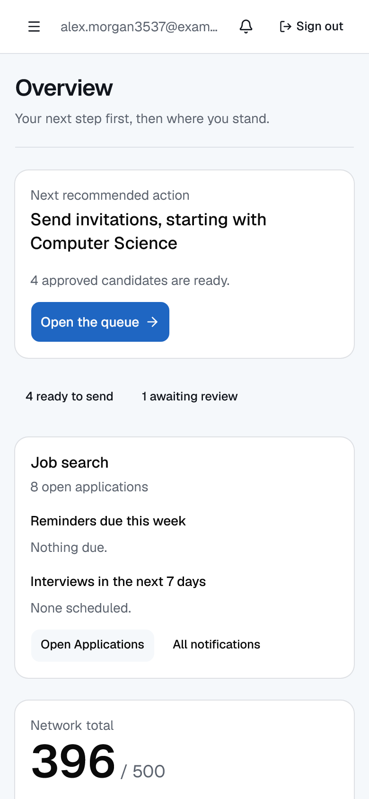

<sub>Fictional data. Every screenshot is generated from the real app with <code>npm run docs:screenshots</code>.</sub>

</div>

---

> ### 🛡️ You stay in control
> The app **never scrapes LinkedIn**, **never sends invitations for you** and **never asks for your LinkedIn password**. You open every profile and send every message yourself. It only reads what you paste, import or search for in public sources, and it tells you where every fact came from.

## 📑 Contents

[✨ Showcase](#showcase) · [🧰 What it does](#what-it-does) · [🖼️ Gallery](#gallery) · [📅 How a day works](#how-a-day-works) · [🚀 Quick start](#quick-start) · [⚙️ Configuration](#configuration) · [✅ Checks](#checks) · [☁️ Deploying](#deploying) · [🏗️ How it is built](#how-it-is-built) · [🔒 Privacy](#privacy) · [🩺 Troubleshooting](#troubleshooting) · [⚠️ Limits](#limits) · [🤲 Contributing](#contributing)

---

<a id="showcase"></a>

## ✨ Showcase

Four things that make this different from a spreadsheet.

### 1. ⚡ Quick capture: paste a LinkedIn search page, get a clean list

On a LinkedIn people search, press **Ctrl+A, Ctrl+C**. Back in the app, press **Ctrl+V**. Everyone on the page appears with their school and program already matched to **your own** lists, ready to add in one click. Nothing is fetched from LinkedIn: only what you copied is read.

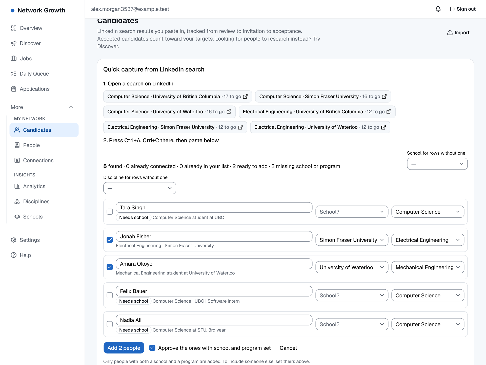

- 🎯 Matches schools and programs from the wording on the page, using the aliases you set (so "UBC", "U of T" and "UofT" mean what you say they mean).
- 🧹 Skips people you already have and people you're already connected to; flags rows that need a school or program instead of guessing.
- 🔁 After you add the page, the cursor goes back to the paste box: the next page is one Ctrl+V away.

### 2. 🔎 Discover: people worth meeting, with the receipts

Ask in plain language: *"Find 5 UofT Computer Engineering alumni working as software engineers in Canada."* A research assistant searches public sources (GitHub, ORCID and optional web search), then **verifies the best matches on their own pages**. It never visits LinkedIn.

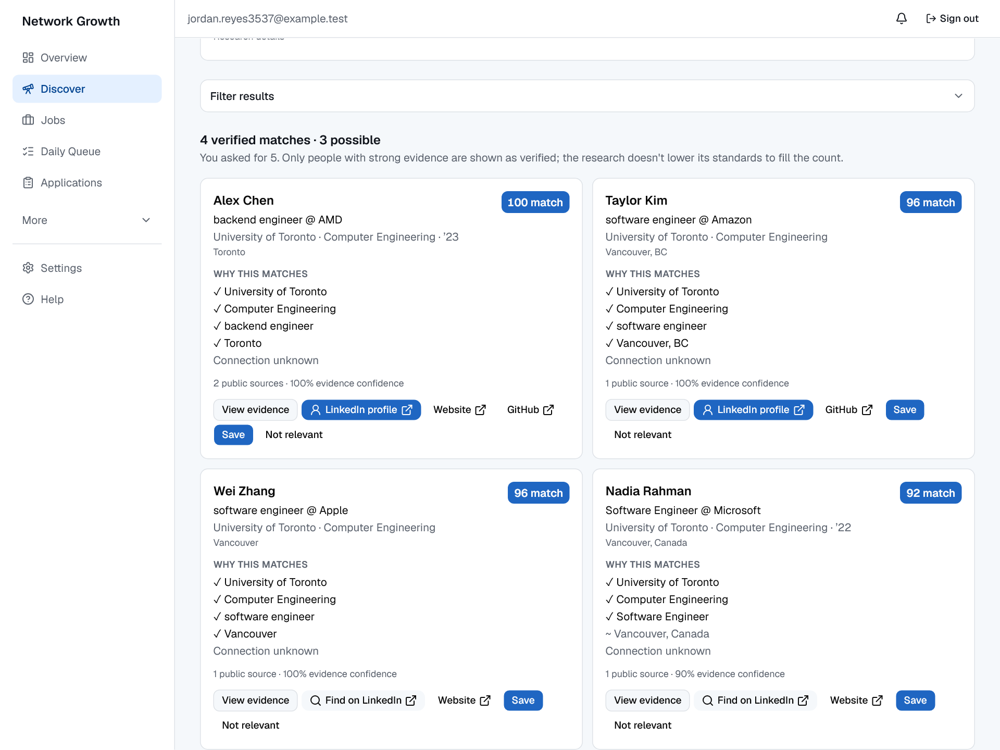

- 📎 **Every fact quotes its source.** The server checks each quote against the page and drops anything it can't find.
- 🧮 **Scores are rules, not vibes.** Education, program, career, company, location and evidence each add a visible number you can inspect.
- 🧭 **It returns fewer people rather than lowering the bar.** Lookalike schools, people outside your country and people you already know are set aside, with the reason shown.

<details>
<summary><b>See the evidence drawer</b> (quotes, links, score breakdown, intro message)</summary>
<br />
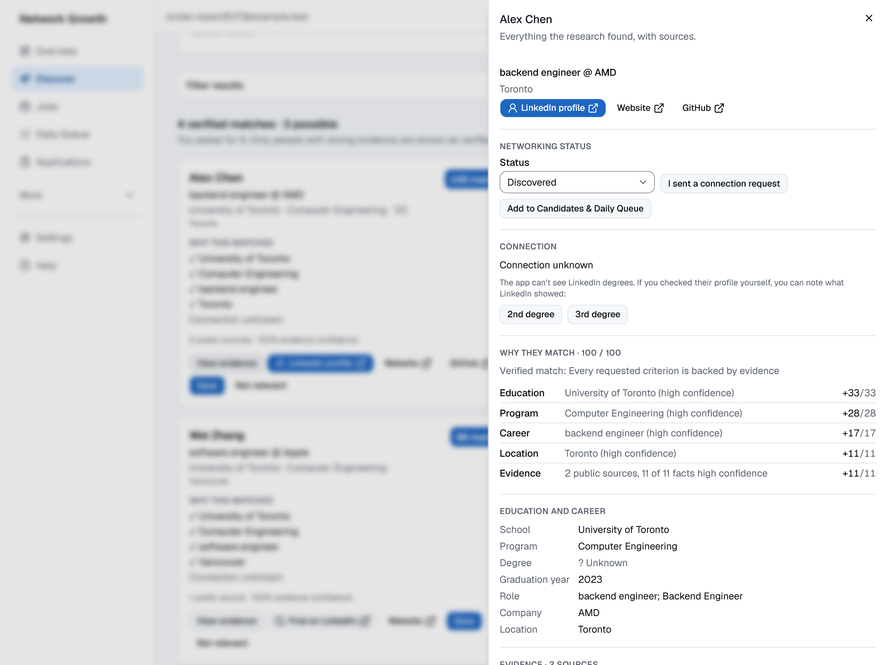
</details>

### 3. 💼 Jobs: real postings, verified links, fit explained

Search recent jobs in any country and any field. Postings come from **employers' own job boards** (Greenhouse, Lever, Ashby, SmartRecruiters, Workable, Recruitee and Workday) plus free remote-job feeds, and every link is checked before **Apply** turns on.

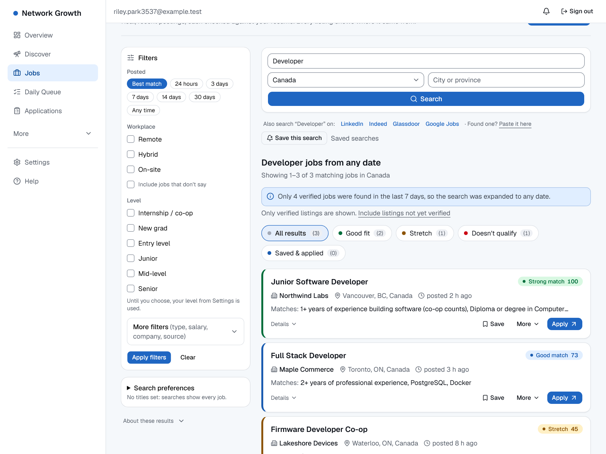

- ✅ **Verified, or it doesn't get an Apply button.** Links come from the source's own data, never from a pattern or a model.
- 📐 **Fit is explained.** Each requirement is matched against your resume and the card says why: strong matches, what's missing, what's preferred.
- 📄 **Tailor your resume honestly.** AI rewrites a copy only if an accuracy check can back every line; otherwise you get specific improvement notes. Nothing is faked.
- 🔔 Save a search to get alerts in the app (and by email, if you turn that on).

### 4. 📈 Honest progress: pending never counts

Set your own goal, schools, disciplines and targets. The Overview shows where you stand against each one. **Only accepted invitations count toward a target**, and pending ones are shown apart in a hatched segment, so the numbers never flatter you.

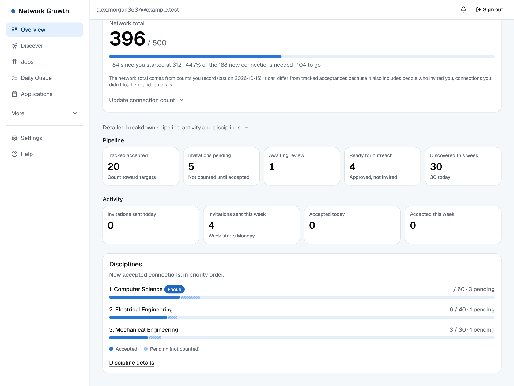

- 🧾 The network total comes from counts you record or import, and the page says so, including why it can differ from tracked acceptances.
- 🗂️ Nothing is built in: you define the schools, disciplines, targets and goal. Nursing, law, design or software all work the same.

---

<a id="what-it-does"></a>

## 🧰 What it does

| | Area | What you get |
|---|---|---|
| 👥 | **Network** | Candidates with search, de-duplication and status. Quick capture from a page you copy yourself. CSV and LinkedIn data-export import. A daily queue ordered by your priorities, with suggested connection notes. |
| 🔭 | **Discover** | A research assistant that finds people worth meeting from public sources. Every fact quotes its source. It never visits LinkedIn. |
| 📇 | **People** | A small CRM: status, notes, tags, reminders, referrals and "people at this company". |
| 💼 | **Jobs** | Recent postings from employers' own boards plus free remote feeds. Verified links, fit checks against your resume, tailored resumes and cover letters, and saved-search alerts. |
| 🗂️ | **Applications** | A board and a list from saved to offer, with timeline, interviews, reminders, contacts, documents and calendar (`.ics`) export. |
| 📊 | **Overview and Analytics** | Progress toward your goal, by discipline and school. Nothing is estimated or invented. |
| 👤 | **Your account** | Sign in with Google or an email link. Export or delete all your data from Settings. Light and dark themes, adjustable density and text size. |
| 📱 | **Phone friendly** | Lists become cards, filters tuck behind a button, touch targets are bigger and dropdowns use your phone's own picker. |

For the detail behind Discover and Jobs, see the [feature guide](docs/FEATURES.md).

<a id="gallery"></a>

## 🖼️ Gallery

<table>
  <tr>
    <td width="50%"><a href="docs/images/applications.png">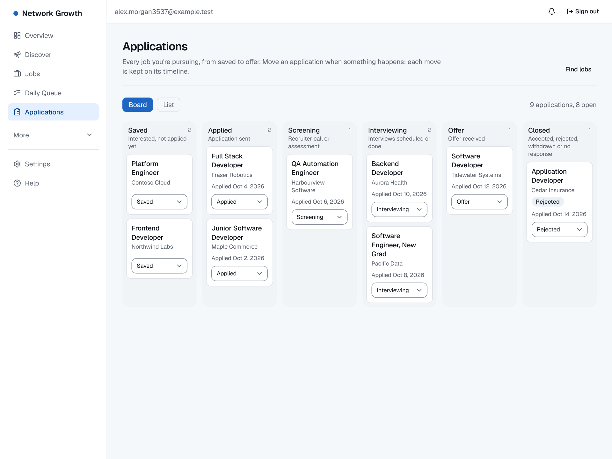</a><br /><sub><b>🗂️ Applications board</b>: every job from saved to offer, each move kept on a timeline.</sub></td>
    <td width="50%"><a href="docs/images/analytics.png">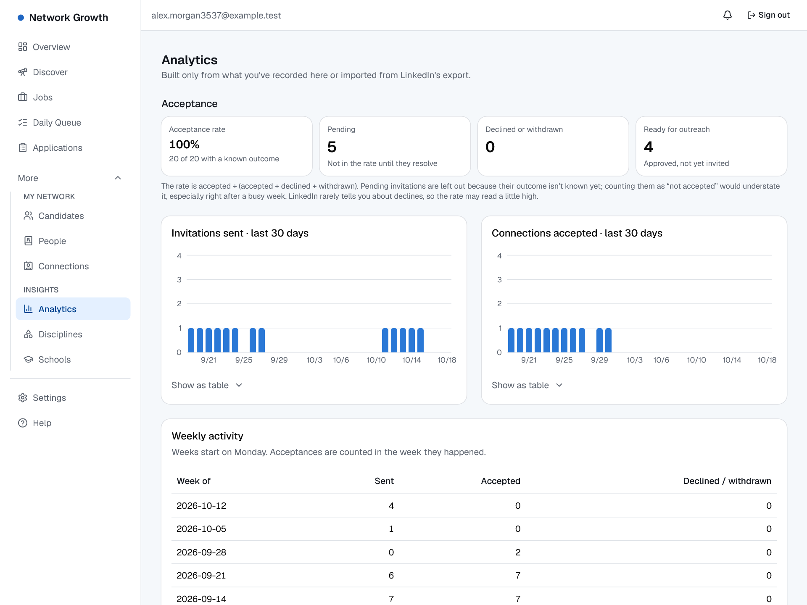</a><br /><sub><b>📊 Analytics</b>: acceptance rate that leaves out unresolved invitations, plus weekly activity.</sub></td>
  </tr>
  <tr>
    <td width="50%"><a href="docs/images/resume.png">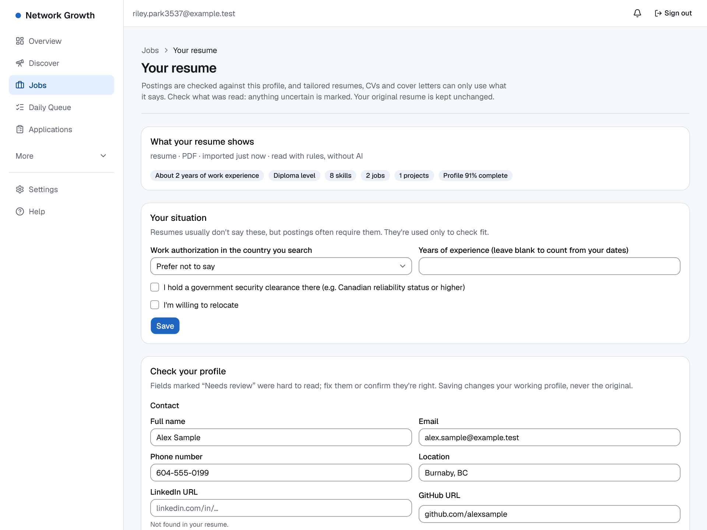</a><br /><sub><b>📄 Resume</b>: read without AI; uncertain fields are marked <i>Needs review</i> with the reason.</sub></td>
    <td width="50%"><a href="docs/images/overview-dark.png">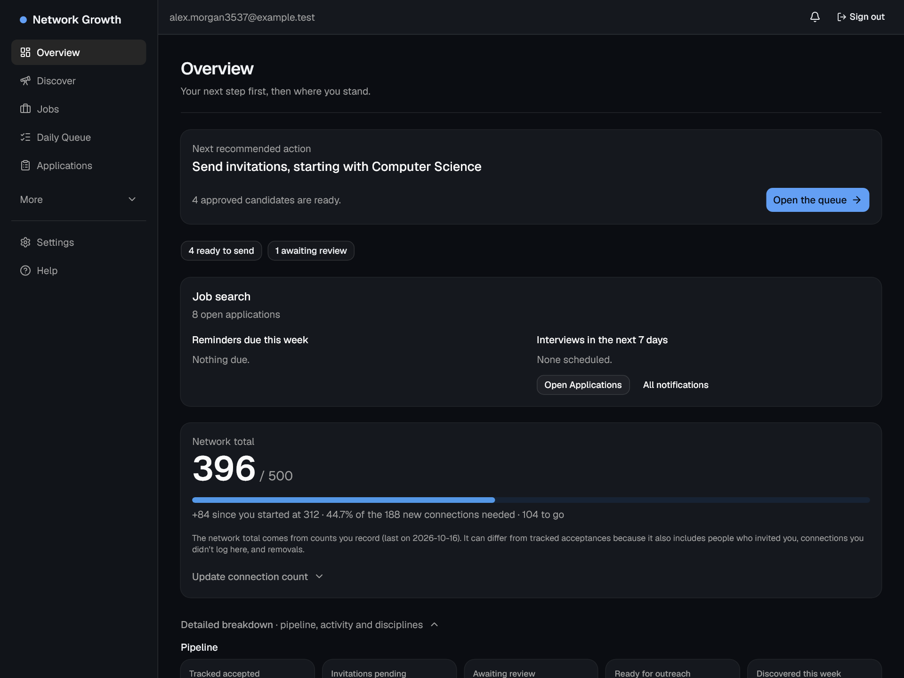</a><br /><sub><b>🌙 Dark theme</b>: light, dark or follow your system, with density and text size controls.</sub></td>
  </tr>
</table>

<div align="center">

### 📱 On a phone


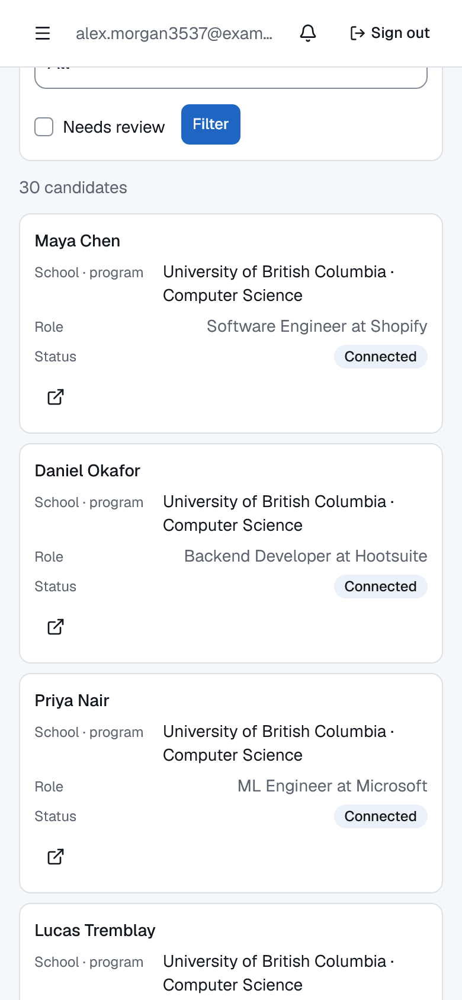
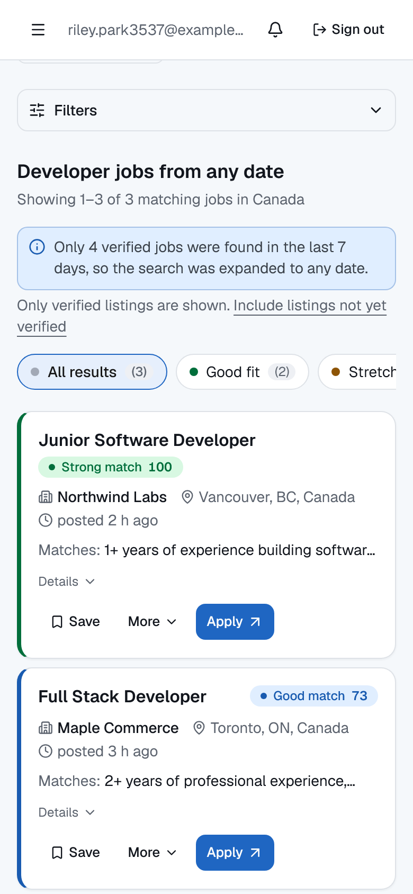
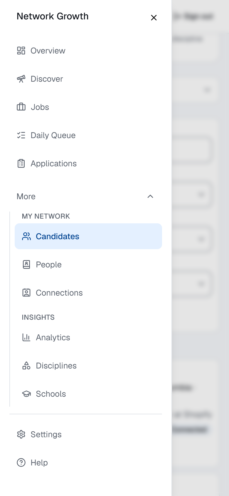

<sub>Overview · Candidates as cards · Jobs · Menu</sub>

</div>

<a id="how-a-day-works"></a>

## 📅 How a day works

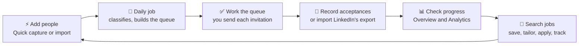

1. **Add people fast.** On a LinkedIn people search, press Ctrl+A then Ctrl+C. In **Candidates → Quick capture**, press Ctrl+V. Fix any blanks, then press **Add**.
2. **Let the daily job run** (or press **Run now**). It classifies new candidates, marks older invitations as pending and builds today's queue within your daily target.
3. **Work the queue.** Open each profile on LinkedIn, send the invitation yourself, then press **Mark sent**.
4. **Record acceptances.** Mark them on the person's record, or import LinkedIn's data export to update everyone at once.
5. **Check progress** on Overview, Disciplines, Schools and Analytics.
6. **Search jobs.** Save a search to get alerts, track what you apply for, and look up people you know at each company.

<a id="quick-start"></a>

## 🚀 Quick start

You need **Node 24** and **Docker Desktop** (running).

```sh
npm install
npm run db:start            # starts local Supabase in Docker and applies migrations
cp .env.example .env.local
npx supabase status         # copy the publishable key and secret key into .env.local
npm run dev                 # http://localhost:3000
```

Then:

1. Set `CRON_SECRET` in `.env.local` to any random string of 16 or more characters.
2. Open http://localhost:3000 and enter your email.
3. Local sign-in emails never leave your machine. Open **Mailpit** at http://127.0.0.1:54324 and click the link.

Google sign-in works only on a deployed site that has Google configured. Locally, use the email link.

> [!CAUTION]
> **Careful with `npm run db:reset`.** It erases your local database. If it holds data you want, apply new migrations with `npx supabase migration up --local` instead.

<details>
<summary><b>📜 npm scripts</b></summary>

| Script | What it does |
|---|---|
| `npm run dev` / `build` / `start` | Run, build and serve the app. |
| `npm run typecheck` / `lint` | Type-check and lint. |
| `npm test` | Vitest unit tests. |
| `npm run test:db` | pgTAP: security rules and data constraints (needs `db:start`). |
| `npm run test:e2e` | Playwright end to end (needs `db:start`). |
| `npm run check:bundle` | Confirms no AI key reaches the browser (run after a build). |
| `npm run db:start` / `db:reset` / `db:types` | Local Supabase, and regenerate the database types. |
| `npm run employers:discover` / `employers:load` | Employer directory tools for the job crawler. |
| `npm run docs:screenshots` | Regenerates the pictures in this README from the real app. |

</details>

<a id="configuration"></a>

## ⚙️ Configuration

Copy `.env.example` to `.env.local` for local work. On Vercel, add the same names under **Settings → Environment Variables** for the **Production** environment. Variable names must match exactly: a misspelled name is silently ignored.

**Required**

| Name | Purpose |
|---|---|
| `NEXT_PUBLIC_SUPABASE_URL` | Your project address, such as `https://<ref>.supabase.co`. Not the dashboard address. |
| `NEXT_PUBLIC_SUPABASE_PUBLISHABLE_KEY` | Browser key. Access is enforced by row-level security. |
| `SUPABASE_SECRET_KEY` | Server only. Bypasses row-level security. Used by scheduled jobs and account deletion. |
| `CRON_SECRET` | Server only. Authenticates scheduled calls to `/api/cron/*`. Must match the value Supabase stores for its scheduled calls. |

**Recommended**

| Name | Purpose |
|---|---|
| `GEMINI_API_KEY` | Free key from [Google AI Studio](https://aistudio.google.com/apikey). Turns on AI features. Without it, every feature uses its non-AI path. |
| `AI_DAILY_QUOTA` | AI uses per user per day on your key. Unset means no limit, so set it on a public site. `0` means users' own keys only. |
| `APP_ENCRYPTION_KEY` | 32+ random characters. Lets users store their own AI key. Never change it once keys are stored. |
| `EMBED_SECRET` | 16+ random characters. Turns on matching by meaning (see [Deploying](#deploying)). |
| `GITHUB_TOKEN` | Free token with no scopes. Raises GitHub's limit for Discover. |
| `NEXT_PUBLIC_CONTACT_EMAIL`, `NEXT_PUBLIC_OPERATOR_NAME` | Shown on the Privacy Policy and Terms pages. Set them before launch. |
| `NEXT_PUBLIC_FEEDBACK_URL` | A `mailto:` or form link. Shows a **Send feedback** button in the navigation. |

**Optional**

| Name | Purpose |
|---|---|
| `GEMINI_MODEL` | Gemini model to use. Default `gemini-3.8-flash`. |
| `ANTHROPIC_API_KEY` | Use Anthropic Claude when `GEMINI_API_KEY` is not set. |
| `BRAVE_SEARCH_API_KEY` | Adds public web search to Discover. |
| `CAREERJET_API_KEY` | Adds Careerjet to job searches (free publisher key). |
| `ADZUNA_APP_ID`, `ADZUNA_APP_KEY` | Adds Adzuna to job searches. |
| `USAJOBS_API_KEY`, `USAJOBS_EMAIL` | Adds U.S. federal jobs. |
| `SMTP_HOST`, `SMTP_PORT`, `SMTP_USER`, `SMTP_PASS`, `SMTP_FROM` | Email digests for saved-search alerts. |
| `APP_URL`, `EMAIL_TOKEN_SECRET` | Also needed for alert emails (links and one-click unsubscribe). `EMAIL_TOKEN_SECRET` needs 32+ characters. |

Alert emails switch on only when `SMTP_HOST`, `SMTP_FROM`, `APP_URL` and `EMAIL_TOKEN_SECRET` are all set, and each person opts in. Otherwise alerts appear only in the app.

**Tests only.** `DISCOVERY_FIXTURES` and `JOBS_FIXTURES` switch on built-in fictional data. Never set them in production. They are ignored in production builds.

Sign-in email for other people needs custom SMTP in Supabase (Authentication → Emails → SMTP Settings). Supabase's built-in email reaches only your own team.

<a id="checks"></a>

## ✅ Running the checks

```sh
npm run typecheck
npm run lint
npm test              # Vitest unit tests
npm run test:db       # pgTAP: security rules and data constraints (needs db:start)
npm run test:e2e      # Playwright end to end (needs db:start)
npm run build
npm run check:bundle  # confirms no AI key reaches the browser (run after build)
```

The last full run passed **894 unit tests, 222 database tests and 44 end-to-end tests** (desktop and phone), plus the build and the bundle check.

| Quality | Result |
|---|---|
| ♿ Lighthouse accessibility, best practices, SEO (production, mobile, signed in) | **100** on every page measured |
| ⚡ Lighthouse performance (production, mobile) | 93–99 on 11 of 12 pages; Settings 82 (see below) |
| 🎨 Colour contrast | Every text and form-field pair is unit-tested in both themes (`src/lib/contrast.test.ts`) |

Settings scores lower in the lab only because its heading paints early, which puts the page's one startup task inside the measured window. In a real browser with a throttled CPU it runs the same two short tasks as every other page.

After you change a migration, run the new migration locally, then `npm run db:types` to regenerate `src/lib/supabase/database.types.ts`. A unit test does not replace a screen-reader review, which is still to do.

<a id="deploying"></a>

## ☁️ Deploying

The app runs on **Vercel** (web app and one daily job) and **Supabase** (database, sign-in, file storage and an optional embedding function). The full, step-by-step guide is in [docs/DEPLOYMENT.md](docs/DEPLOYMENT.md). In short:

1. Create a Supabase project, then link it and apply the migrations:
   ```sh
   npx supabase login
   npx supabase link --project-ref <your-project-ref>
   npx supabase db push
   ```
2. Import the repository in Vercel and add the environment variables above. The function region is set to `pdx1` in `vercel.json`: keep it next to your Supabase region.
3. In Supabase **Authentication → URL Configuration**, set **Site URL** to your Vercel address and add it, with `/**`, to **Redirect URLs**.
4. Set up custom SMTP, and Google sign-in if you want it.
5. Load the employer directory: `npm run employers:load` (with the project URL and secret key in your environment).
6. Schedule the job crawler (every 5 minutes) and the alerts job (every 15 minutes) with Supabase `pg_cron`. Vercel's free plan runs a cron only once a day. The SQL is in the deployment guide.
7. Optional: `npx supabase functions deploy embed`, for matching by meaning.

The app serves `robots.txt` (crawling allowed), a sitemap and `llms.txt` for its public pages. Pages behind sign-in redirect signed-out visitors, bots included, to `/login`, so only the public pages can be found.

<a id="how-it-is-built"></a>

## 🏗️ How it is built

**Stack.** Next.js 16 (App Router, Cache Components, streaming), TypeScript, Tailwind v4, shadcn/ui on Base UI, Recharts (loaded on demand), Supabase (Postgres, Auth, Storage, RLS), Zod, Vitest, pgTAP and Playwright. AI is Google's Gemini over REST, with optional Anthropic.

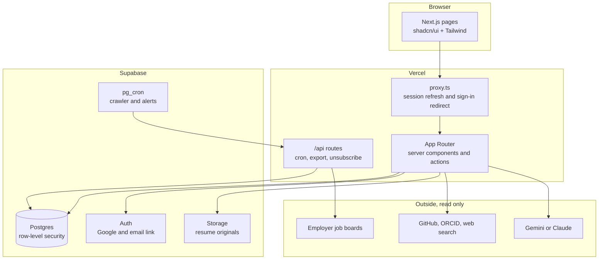

```text
src/app/(app)/     signed-in pages: overview, queue, candidates, discover, people,
                   jobs, applications, companies, notifications, settings, analytics
src/app/api/       cron jobs (daily, crawl, alerts), export, email unsubscribe, JSON endpoints
src/app/login/     sign-in (Google and email link); privacy and terms pages are public
src/lib/           the logic: job-postings, discovery, ai, alerts, applications,
                   progress, classify, net (safe fetching), server, email
src/components/    shared interface pieces (components/ui is shadcn)
src/proxy.ts       refreshes the session and sends signed-out visitors to /login
supabase/          migrations, pgTAP tests, seed employers, the embed function
e2e/               Playwright tests, fixtures and the README screenshot script
scripts/           employer directory tools and the client-bundle check
docs/              deployment guide, feature guide, implementation checklist, images
```

**Design rules worth knowing**

- 🔐 Every table is protected by row-level security and scoped to its owner. Client input never names the user.
- 🌐 Fetching outside URLs goes through `src/lib/net/safe-fetch.ts`, which refuses private and reserved addresses.
- 🧮 Scores, rankings and fit are computed by rules, never by a model. AI writes text, and its output is checked before use.
- 🎯 Counting rules for targets live in `src/lib/progress/`, with unit tests. Only accepted invitations count, and only when the person's school and program are confirmed.
- 🔑 AI keys never reach the browser. `npm run check:bundle` checks the built files.
- ⚡ The first page load stays light: menus, charts, toasts and the desktop dropdown load only when first used.
- 📱 Dropdowns are the shadcn Select on desktop and the phone's own picker on touch devices; lists turn into cards below 768 px.

<a id="privacy"></a>

## 🔒 Privacy and data

- Everything is stored only for your account. Your LinkedIn password and cookies are never stored. Email addresses in imported files are not stored, and the files are not kept.
- Settings can export everything in your account and delete it for good.
- When you use an AI feature, the text it needs (for example your resume and a job posting) goes to the AI provider. **On Gemini's free tier, Google may use it to improve its products.** Use a paid key, or skip AI features, if that matters to you.
- The site has a [Privacy Policy](src/app/privacy/page.tsx) and [Terms of Service](src/app/terms/page.tsx), written to follow British Columbia law. They are a starting point, not legal advice. Have them reviewed before a wide launch.

<a id="troubleshooting"></a>

## 🩺 Troubleshooting

| Symptom | Likely cause and fix |
|---|---|
| Google button shows a Supabase page, or a "not found" page | `NEXT_PUBLIC_SUPABASE_URL` holds the dashboard address. It must be `https://<ref>.supabase.co`. Fix it and redeploy. |
| `Unsupported provider: provider is not enabled` | Turn on Google in Supabase **Authentication → Sign In / Providers** and paste the client ID and secret. |
| Sign-in sends people to a Vercel "request access" page | **Site URL** in Supabase is wrong. Use your public Vercel address, with no path. |
| Scheduled crawl returns `401` | `CRON_SECRET` in Vercel differs from the one stored in Supabase. They must match exactly. Redeploy after changing it. |
| Jobs page is empty | Run `npm run employers:load`, then schedule the crawler. First results take about 10 minutes. |
| "Email isn't set up on this server" in Settings | One of `SMTP_HOST`, `SMTP_FROM`, `APP_URL` or `EMAIL_TOKEN_SECRET` is missing, misspelled, or not set for Production. Redeploy afterwards. |
| Sign-in email never arrives | Supabase needs custom SMTP for anyone outside your team. Check spam, too: free sender addresses are often filtered. |
| "Take the tour" does nothing on a new deployment | The onboarding migration hasn't been applied. Run `npx supabase db push`. |
| A new variable has no effect | Variables apply only to new deployments. Redeploy, and for `NEXT_PUBLIC_` ones, rebuild. |

<a id="limits"></a>

## ⚠️ Limits

- Job coverage follows the employer directory. Large retailers and many big employers use systems with no public API, so in-store retail jobs stay thin. The app does not scrape.
- Jobicy and Remotive list only remote jobs, and Remotive's arrive a day late.
- Gemini's free tier has daily request limits. When they run out, Tailor Resume gives improvement notes instead.
- Links on sites that block automated checks stay **Not yet verified**.
- Still open: restoring from a backup, a staging deployment with smoke checks, and a screen-reader review.

<a id="contributing"></a>

## 🤲 Contributing and licence

Questions, bug reports and ideas are welcome. Please open an issue, or use the **Send feedback** button in the app. If you plan to send a change, run the checks above first and keep the change small and focused. To refresh the pictures in this README after a visual change, run `npm run db:start` and then `npm run docs:screenshots`.

No licence has been chosen yet, so all rights are reserved. Please ask before reusing the code.

This project is not affiliated with LinkedIn, Google or any employer.

<div align="center">
<sub>Built with Next.js, Supabase and shadcn/ui · Your network, your rules.</sub>
</div>
